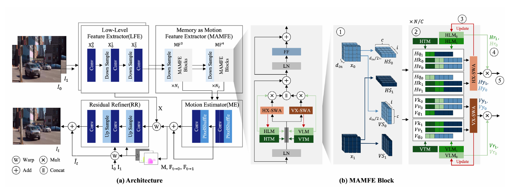

<div align="center">

# 🧠 MAMFI

### Learning Motion at All Scales via Memory-as-Motion Attention for Frame Interpolation

**Min Wu Jeong** · **Chae Eun Rhee**<br>
Department of Electronic Engineering, Hanyang University

[](https://doi.org/10.1109/ACCESS.2025.3635165)
[](https://doi.org/10.1109/ACCESS.2025.3635165)
[](https://drive.google.com/drive/folders/1XkoBc3HrantG26B9XQweV9CwENr6RD_X?usp=sharing)
[](#-license--acknowledgement)
[](https://pytorch.org/)
[](https://developer.nvidia.com/cuda-toolkit)

[Highlights](#-highlights) · [Results](#-results) · [Installation](#%EF%B8%8F-installation) · [Checkpoints](#-checkpoints) · [Datasets](#-datasets) · [Benchmark](#-benchmark) · [Demo](#-demo) · [Citation](#-citation)

</div>

---

## ✨ Highlights

MAMFI is a hybrid **Transformer + RNN** video frame interpolation model that captures both large-scale and fine-grained motion, easing the *seesaw effect* where gains on large motion cost accuracy on small motion (and vice versa).

- 🧠 **Memory-as-Motion** — two complementary motion memories (long-term motion memory and task memory) store large-scale motion and task-level priors.
- 🔀 **Cross Sliding-Window Attention (X-SWA)** — horizontal and vertical cross-frame attention captures dense, local motion between adjacent frames.
- 🔄 **Test-time online learning** — memory is updated adaptively in regions with significant motion while redundant information is discarded.

<p align="center"></p>

---

## 📊 Results

Quantitative comparison with **Test-Time Augmentation (TTA) disabled** (paper Table 2). FLOPs are measured at 1280×720. Best results in **bold**.

### Standard benchmarks

| Model | Vimeo90K<br><sub>PSNR / SSIM</sub> | UCF101<br><sub>PSNR / SSIM</sub> | Xiph-2K<br><sub>PSNR / SSIM</sub> | Xiph-4K<br><sub>PSNR / SSIM</sub> | Middlebury<br><sub>IE ↓</sub> | Params<br><sub>(M)</sub> | FLOPs<br><sub>(T)</sub> |
|:--|:-:|:-:|:-:|:-:|:-:|:-:|:-:|
| Ours-S | 36.14 / **0.9800** | 35.43 / 0.9700 | 36.82 / 0.944 | 34.69 / 0.907 | 2.00 | **5.7** | **0.28** |
| Ours-L | **36.58** / 0.9799 | **35.51 / 0.9702** | **37.31 / 0.947** | **35.13 / 0.911** | **1.89** | 22.6 | 1.11 |

### SNU-FILM

| Model | Easy<br><sub>PSNR / SSIM</sub> | Medium<br><sub>PSNR / SSIM</sub> | Hard<br><sub>PSNR / SSIM</sub> | Extreme<br><sub>PSNR / SSIM</sub> |
|:--|:-:|:-:|:-:|:-:|
| Ours-S | 40.05 / 0.9906 | 36.18 / 0.9807 | 30.83 / 0.9399 | 25.62 / 0.8686 |
| Ours-L | **40.07 / 0.9907** | **36.30 / 0.9809** | **31.02 / 0.9417** | **25.79 / 0.8717** |

---

## 🛠️ Installation

```bash
# 1. Conda environment
conda create -n MAMFI python=3.10 -y
conda activate MAMFI

# 2. PyTorch (CUDA 12.1)
conda install pytorch torchvision torchaudio pytorch-cuda=12.1 -c pytorch -c nvidia

# 3. Dependencies
pip install -r requirements.txt
```

---

## 📦 Checkpoints

Download the pretrained weights from **[Google Drive](https://drive.google.com/drive/folders/1XkoBc3HrantG26B9XQweV9CwENr6RD_X?usp=sharing)** and place them under `./ckpt/`.

| Model | Params (M) | FLOPs (T) |
|:--|:-:|:-:|
| Ours-S | 5.7 | 0.28 |
| Ours-L | 22.6 | 1.11 |

---

## 📁 Datasets

Organize the datasets as follows (default root: `/data/datasets`, change with `--datasets_path`):

```
/data/datasets/
├── middlebury
├── snufilm
├── ucf101
├── vimeo_triplet
└── Xiph
```

| Dataset | Resolution | Test set |
|:--|:-:|:--|
| [Vimeo90K](http://toflow.csail.mit.edu/) | 448×256 | 3,782 triplets |
| [UCF101](https://liuziwei7.github.io/projects/VoxelFlow) | 256×256 | 379 triplets (from DVF) |
| [Xiph](https://github.com/sniklaus/softmax-splatting/blob/master/benchmark_xiph.py) | 2K / 4K | Downsampled to 2K (Xiph-2K), center-cropped (Xiph-4K) |
| [Middlebury OTHER](https://vision.middlebury.edu/flow/data/) | ~640×480 | OTHER set |
| [SNU-FILM](https://myungsub.github.io/CAIN/) | ~1280×720 | 1,240 triplets · Easy / Medium / Hard / Extreme |

---

## 🚀 Benchmark

```bash
make bench_Ours-S
make bench_Ours-L
```

Or run directly with a custom dataset path:

```bash
python model_benchmark.py --model Ours-L --resume Ours-L --datasets_path /path/to/datasets
```

Logs are written to `./benchlog/`.

---

## 🎬 Demo

Interpolate the middle frame between two input frames:

```bash
make demo-L I0=frame0.png I2=frame2.png
# optionally pass the ground-truth middle frame to report PSNR
make demo-L I0=frame0.png I2=frame2.png I1=frame1_gt.png
```

Or call the script directly:

```bash
python demo.py --model Ours-L --resume Ours-L --i0 frame0.png --i2 frame2.png [--i1 gt.png] [--size W H] [--out_dir example]
```

Outputs (an interpolation GIF and a panel with flows and mask) are written to `example/`.

---

## 🙏 License & Acknowledgement

This project is released under the **Apache 2.0** license.
It builds on concepts and code from [RIFE](https://github.com/hzwer/ECCV2022-RIFE), [EMA-VFI](https://github.com/MCG-NJU/EMA-VFI), and [VFIMamba](https://github.com/MCG-NJU/VFIMamba) — please also follow their respective licenses.
We sincerely thank the authors for their excellent work, and [lucidrains](https://github.com/lucidrains) for open-source implementations that were extremely helpful.

---

## 📝 Citation

```bibtex
@article{jeong2025mamfi,
  title   = {MAMFI: Learning Motion at All Scales via Memory-as-Motion Attention for Frame Interpolation},
  author  = {Jeong, Min Wu and Rhee, Chae Eun},
  journal = {IEEE Access},
  volume  = {13},
  pages   = {199126--199137},
  year    = {2025},
  doi     = {10.1109/ACCESS.2025.3635165}
}
```
